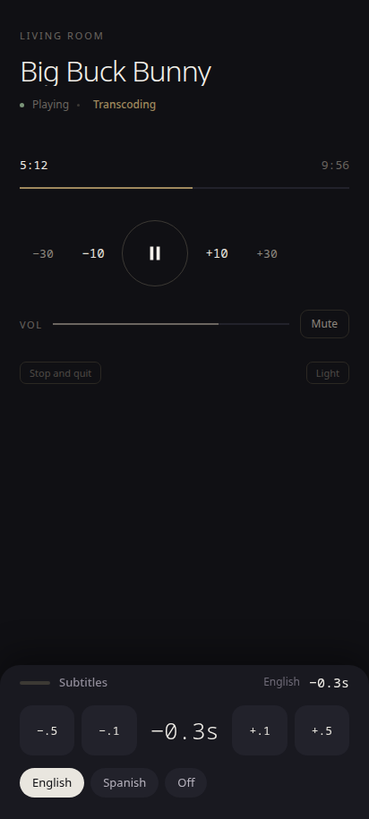
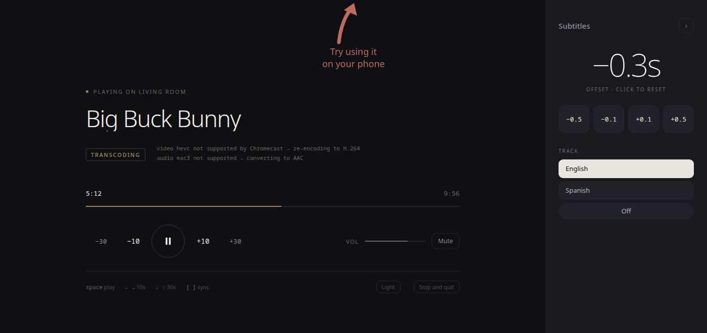
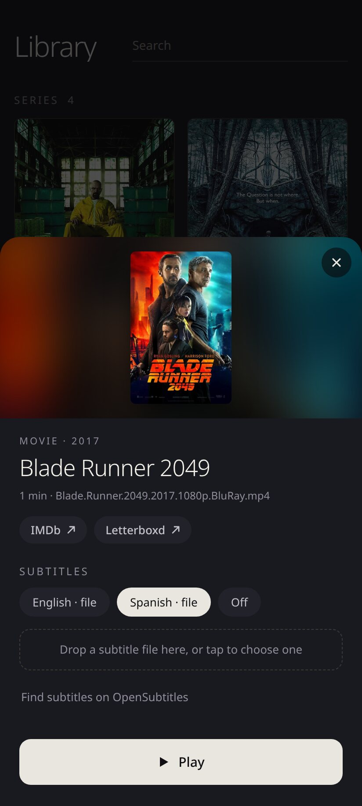
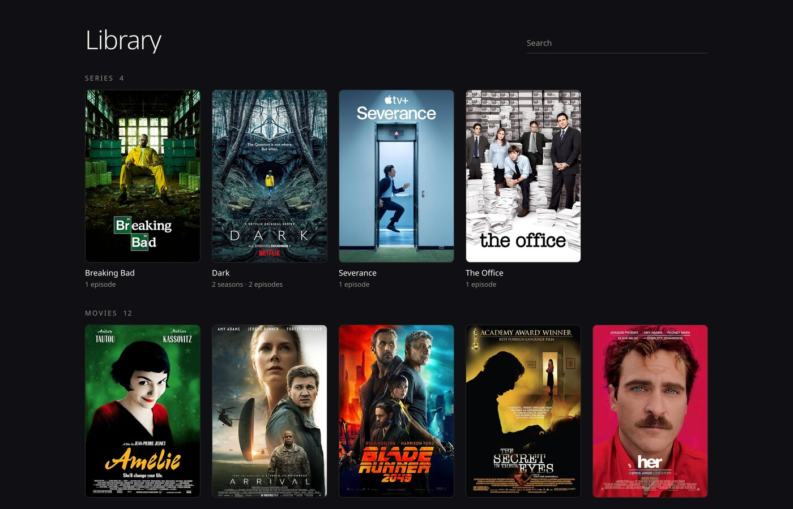

# LTC: linuxtochromecast

<br clear="left">

Cast a video to your Chromecast with subtitles already working, in one command:

```bash
ltc movie.mkv
```

That's it. It finds the Chromecast, picks up the subtitles (embedded or the
`.srt` sitting next to the file), works out whether anything needs converting,
and starts playing.

Bring whatever format you already have. ffmpeg does the reading, so a file it
can't open is rare, and anything the Chromecast can't play gets converted on the
fly.

---

## Why it exists

With VLC you pick the device by hand, cross your fingers about the format, and
the subtitles simply don't make it: VLC renders them locally, so casting drops
them. The usual workaround is burning them into the video, which takes forever
and can't be turned off afterwards.

Here the subtitles are sent to the Chromecast as **real text tracks**. You turn
them on, off, and switch languages instantly, without re-encoding anything.

---

## Installation

```bash
git clone https://github.com/ValengoIsRoxas/linuxtochromecast
cd linuxtochromecast
./install.sh
```

The script installs ltc with [pipx](https://pipx.pypa.io) (so it lives in its
own environment and `pipx upgrade` / `pipx uninstall` work as usual), then runs
`ltc setup`, a short guided setup where **every question has a default: press
Enter to accept it**:

- the **library folder** with your movies and series (subfolders are scanned);
- where to keep **saved conversions** (they are big, so you may want another
  disk) and how much space they may use, suggested from the free space;
- the preferred **subtitle language**;
- your **Chromecast**, found on the network, so it isn't asked every time;
- the **port** of the panel, checking whether the firewall blocks it and offering
  to open it;
- whether to look up **posters** on IMDb, and optional **OpenSubtitles** credentials;
- a **Send to Chromecast** entry in your file manager's right-click menu.

Requirements are Python 3.11+, ffmpeg and pipx. If ffmpeg or pipx is missing the
script offers to install it with your distro's package manager (dnf, apt,
pacman or zypper); that is the only time it uses `sudo`, and only if you agree.

```bash
./install.sh --yes       # no questions, all defaults
./install.sh --dev       # editable install: code changes apply immediately
ltc setup                # run the guided setup again any time
ltc uninstall            # remove ltc, and optionally its data
```

Installed with the old script (a `.venv` inside the repo)? Run `./install.sh`
again: it replaces the old `ltc` command with the pipx one, and the repo's
`.venv` stops being used.

---

## Configuration

Everything `ltc setup` asks lives in `~/.config/ltc/config.toml`. You can see and
change it without editing the file:

```bash
ltc config                             # every option, and whether you changed it
ltc config set library.folder ~/Videos
ltc config set storage.converted_dir /mnt/big-disk/ltc
ltc config unset storage.cache_limit_gb    # back to the default
ltc config edit                        # open the file in $EDITOR
```

With a library folder set, plain `ltc` opens it. Command-line options still win
over the file, for one run.

| Option | Default | |
|---|---|---|
| `library.folder` | none | movies and series, subfolders included |
| `library.posters` | `true` | look up posters on IMDb |
| `storage.cache_dir` | `~/.cache/ltc` | thumbnails, posters, log |
| `storage.converted_dir` | `<cache_dir>/converted` | saved conversions |
| `storage.cache_limit_gb` | `40` | disk for conversions; `0` = don't keep them |
| `playback.sub_lang` | `spa` | preferred subtitle language |
| `playback.sub_scale` | `1.0` | subtitle size |
| `playback.surround` | `false` | keep multichannel audio |
| `playback.autoplay_next` | `true` | library mode: next episode on its own |
| `device.name` | none | Chromecast by name or IP; none = look around |
| `network.port` | `8642` | port of the panel |
| `performance.hwaccel` | `true` | re-encode on the GPU when there is one |
| `opensubtitles.api_key` / `.username` / `.password` | none | see below |

Changing `storage.converted_dir` offers to move the conversions already saved.
Partial encodes are written next to the saved ones, so the final step is a rename
on the same disk and not a copy of several gigabytes.

---

## Usage

```bash
ltc movie.mkv                  # cast, picking subtitles automatically
ltc show.mkv -s 2              # use subtitle track number 2
ltc movie.mp4 -s other.srt     # use a specific subtitle file
ltc movie.mkv --list-tracks    # show what's inside the file and exit
ltc --list-devices             # show the Chromecasts on your network
ltc movie.mkv -d "Living"      # pick the device by name
ltc movie.mkv -t 45:30         # start at 45 minutes 30 seconds
ltc ~/Videos                   # browse a whole folder from your phone
```

While it runs, the terminal accepts:

| Key | Action |
|---|---|
| `space` | pause / resume |
| `←` `→` | ±10 seconds |
| `↓` `↑` | ±30 seconds |
| `j` `k` | volume |
| `m` | mute |
| `s` | cycle subtitle track |
| `[` `]` | nudge subtitle sync |
| `0` | reset subtitle sync |
| `q` | quit |

### The web panel

It also opens a control panel in your browser with the same controls. The
address it prints on startup (`http://192.168.x.x:8642`) even **works from your
phone** if it's on the same network, so it doubles as a remote control — pretty
useful.

The port is always 8642 (unless something else holds it), so save the address
on your phone's home screen once and it keeps working. The IP part is up to
your router: give your computer a fixed one with a *DHCP reservation* and the
address never changes.

<p>
  
  
</p>

Subtitle sync gets the most visual weight on purpose — it's the one thing VLC
can't do. Nudge it in 0.1s or 0.5s steps, or tap the offset itself to reset it.

### Library mode

Point it at a folder instead of a file and it stays running as a little media
center you drive from your phone:

```bash
ltc ~/Videos
```

The panel turns into a library: movies, series grouped by season, and a
*Continue watching* row. Pick something, choose the subtitles (and the audio
track, if there's more than one), and it starts on the TV; the regular remote
is one tap away. It remembers where you left each video, and when an episode
ends the next one starts on its own (`--no-autoplay` turns that off).

<p>
  
  
</p>

Everything comes from your own files; the only thing looked up online is
the artwork:

- **Names.** Series are recognized by `S01E03`, `1x03`, or a `Season 1` /
  `Temporada 1` folder; anything else is a movie. Release junk (`1080p`,
  `BluRay`, `x264`, `Criterion`, …) is stripped from titles, and the year is kept.
- **Artwork.** Movies and series show a poster: a `poster.jpg` /
  `folder.jpg` already in the folder, or `<video>.jpg` next to the file;
  otherwise the one from IMDb (its public search, no key or account), cached
  in `~/.cache/ltc/posters`. With no poster anywhere, a frame of the video.
  Episodes and *Continue watching* use frames grabbed from the video, cached
  in `~/.cache/ltc/thumbs`. `--no-posters` keeps everything offline.
- **Links.** A movie's detail sheet links to its IMDb and Letterboxd pages;
  an episode's, to its series on IMDb.
- **Progress** lives in `~/.local/share/ltc/progress.json`, keyed by path.

Files the Chromecast can't play as they are get converted first: **Play**
sends you back to the library, where a striped bar under the poster fills up
with the conversion (and says how long is left), and the movie starts on the
TV by itself when it's ready, with real seeking from the first second. If you
can't wait, *Play right now instead* streams it through the ffmpeg pipe while
it converts (no seeking until it's done). The red bar under each poster is how
much of it you've watched.

#### Your own subtitle files

Drop a `.srt` / `.ass` / `.vtt` onto the detail sheet (or tap the dashed box
to choose one, which is how it works on a phone). It's saved next to the video
and selected right away. A name like `Movie.es.srt` keeps its language;
otherwise the track is labelled with the file name. Files that can't be read
as subtitles are refused instead of saved.

#### Subtitles from OpenSubtitles

The detail sheet has *Find subtitles on OpenSubtitles*. It searches by the
file's hash first (a match was uploaded for that exact release, so it's in
sync), then by title, and saves what you pick next to the video as
`<video>.spa.srt`, after which it's just another local file. This is the
only thing in library mode that goes online, and only when you press it.

It uses the opensubtitles.com API (the old opensubtitles.org one was shut
down), which needs an API key to search and a free account to download:

```bash
ltc config set opensubtitles.api_key …
ltc config set opensubtitles.username …
ltc config set opensubtitles.password …
```

The config file is created readable only by you. `LTC_OPENSUBTITLES_API_KEY`,
`_USERNAME` and `_PASSWORD` work too and take priority, and the old
`~/.config/ltc/opensubtitles.json` is still read for whatever the config doesn't set.

### Saved conversions

Re-encoding an HEVC episode takes minutes, so finished conversions are kept in
`~/.cache/ltc/converted` (`storage.converted_dir` changes it). Next time the same file starts instantly, with real
seeking, in either mode. The key is the source file plus how it was
converted, so a changed file or a different audio track never gets a stale
conversion.

The cache keeps up to 40 GB and drops whatever was used longest ago;
`storage.cache_limit_gb` (or `--cache-size 100` for one run) changes that, and
`0` turns it off. Remuxes aren't
kept: they redo in seconds and would take as much space as the original.

### Re-encoding on the GPU

When a file has to be re-encoded, ltc uses the GPU, not the CPU. It prefers an
NVIDIA card (NVENC, with decoding on NVDEC) and falls back to VAAPI (usually
the integrated graphics of the processor), then to x264 on the CPU. Each
option is test-encoded once at startup, so a driver that doesn't really work is
skipped. The terminal shows which one it picked.

`LTC_HWACCEL=vaapi` skips NVENC, `LTC_HWACCEL=nvenc` never falls back to VAAPI,
and `--no-hwaccel` (or `LTC_NO_HWACCEL=1`) forces the CPU. NVENC needs an ffmpeg
built with it and the proprietary NVIDIA driver.

---

## How it decides what to do with the file

It always takes the cheapest of three paths:

| Mode | What it does | Cost | Seeking |
|---|---|---|---|
| **direct** | Serves the file untouched | none | native, instant |
| **remux** | Swaps the container without touching the video (`-c copy`) | negligible | restarts the stream |
| **transcode** | Re-encodes whatever is needed | CPU | restarts the stream |

An MP4 with H.264 and stereo AAC plays directly. An MKV with those same codecs
only needs a remux, which is essentially free. Re-encoding kicks in only when
the device genuinely can't decode something: AC3 or DTS audio, HEVC video on an
older Chromecast, 10-bit, 4:4:4.

**Channel count matters too.** A regular Chromecast decodes AAC but not
multichannel AAC: if you look at the codec alone, the movie starts, plays for a
few seconds, and dies with `MEDIA_SRC_NOT_SUPPORTED`. So when a file carries
more channels than the device handles, the audio is downmixed to stereo. It's
cheap, because the video is copied untouched and only the audio is re-encoded.
`--surround` forces it through as-is.

It tells you which path it chose and why:

```
  mode   transcoding
  video  hevc 1920x1080 → libx264
  audio  eac3 · Spanish · 6ch → aac
         video hevc not supported by Chromecast → re-encoding to H.264
         audio eac3 not supported → converting to AAC
         6-channel eac3 audio: Chromecast only plays 2 → downmixing to stereo
         (--surround to try keeping it)
```

You can override with `--transcode` or `--direct` if you know better.

### How the stream is delivered

When the output goes through ffmpeg there's no way to know its final size in
advance, so `Transfer-Encoding: chunked` would be the natural choice. **It
doesn't work:** the receiver rejects the MP4 with `LOAD_FAILED` without
rendering a single frame. It needs a `Content-Length`, so it gets an estimated
one, deliberately on the high side — overshooting means the connection drops
once the movie is already over, undershooting would cut off the ending.

### Seeking when ffmpeg is in the path

In remux or transcode mode the output is a pipe, and a pipe can't serve range
requests: the stream always starts at zero. So seeking works by killing ffmpeg
and restarting it at the requested point, while the program keeps track of what
that zero is worth in real movie time. Subtitles are served shifted by the same
amount, so they never drift.

When the video is copied rather than re-encoded, ffmpeg can't start at an
arbitrary point — only at the preceding keyframe. The program looks up where
that is and uses it as the zero for the subtitles too. Without that, they'd be
off by up to several seconds.

---

## Subtitles

Found automatically:

- tracks embedded in the MKV or MP4;
- files next to the video: `movie.srt`, `movie.es.srt`,
  `movie.spa.forced.srt`, and anything inside a `Subs/` folder.

SRT, ASS, SSA, SUB and VTT are converted to WebVTT, the only format the receiver
understands. ASS styling and positioning are dropped; italics and bold survive.

Which one gets enabled: the track in your language (`--sub-lang`, Spanish by
default), preferring regular over forced. If there's exactly one track and it
doesn't even declare a language — the `movie.mp4` + `movie.srt` case — it gets
enabled anyway, on the reasoning that a lone `.srt` next to a movie is there to
be watched. If it declares a language other than the one you asked for, it is
not enabled automatically; press `s` or use the panel.

### Character encoding

`.srt` files don't record their encoding anywhere, and most of the ones in
circulation for Spanish are latin-1 or cp1252 rather than UTF-8. Automatic
detectors fail exactly here: `cp1250` and `cp1252` differ in a handful of bytes,
and one of them is `0xF1` — `ñ` in cp1252, `ń` in cp1250. Statistically they're
indistinguishable.

Since the track's language is already known (from the MKV tag or from the
`.es.srt` in the filename), it's used as the tie-breaker: the winning encoding is
the one that produces the most letters from the expected alphabet. If it still
comes out wrong:

```bash
ltc movie.mkv --sub-encoding cp1252
```

### Sync

If the subtitles are off, `[` and `]` shift them by 0.1 seconds at a time, and
the web panel has ±0.1 and ±0.5 buttons. You can also start with a fixed offset:

```bash
ltc movie.mkv --delay -2.5
```

### Image-based subtitles

Blu-ray and DVD subtitles (PGS, VobSub) are images, not text, so they can't be
sent as a track. The only option is burning them into the video, which forces a
re-encode:

```bash
ltc movie.mkv --burn 1
```

`--list-tracks` marks which ones are image-based.

---

## Options

These override the configuration for one run. Every default below is the one
from `ltc config`.

```
  -d, --device NAME       Chromecast to use (partial name, or its IP)
  -s, --sub N|FILE        subtitle track, by number or by file
      --no-subs           start with subtitles off
      --burn N            burn track N into the video
      --sub-lang CODE     preferred language when auto-selecting (default: spa)
      --sub-scale F       subtitle size, 1.0 = normal
      --sub-encoding ENC  force the encoding of external .srt files
      --delay SECONDS     initial subtitle offset
  -a, --audio N           audio track
  -t, --start TIME        start at 90, 1:30 or 1:02:03
  -p, --port N            local server port (default 8642; 0 = random)
      --cache-size GB     disk for saved conversions (default 40; 0 = off)
      --transcode         force re-encoding
      --direct            force direct playback
      --surround          don't downmix multichannel audio to stereo
      --no-hwaccel        re-encode on the CPU even if a GPU could do it
      --no-autoplay       library mode: don't start the next episode on its own
      --no-posters        library mode: don't fetch posters from IMDb
      --no-browser        don't open the web panel
      --list-devices      list the Chromecasts on the network
      --list-tracks       list the file's tracks
```

---

## Troubleshooting

**It can't find the Chromecast, or takes ages to start.** Discovery uses mDNS,
which doesn't always cross the network (VLANs, guest Wi-Fi, some routers). Get
the IP once with `ltc --list-devices` and then use it directly, which skips
discovery entirely:

```bash
ltc movie.mkv -d 192.168.1.50
```

**Video plays but no subtitles.** Almost always CORS: the receiver fetches the
`.vtt` over XHR and silently discards it if the `Access-Control-Allow-Origin`
header is missing. This program always sends it, so if it happens, check that
your firewall isn't blocking the local server's port. `ltc setup` checks this
and offers to open it; by hand:

```bash
sudo firewall-cmd --add-port=8642/tcp                 # Fedora, until reboot
sudo firewall-cmd --add-port=8642/tcp --permanent     # and from then on
sudo ufw allow 8642/tcp                               # Ubuntu
```

**It starts and cuts out after a few seconds.** That's the classic multichannel
audio symptom: the receiver accepts the file, begins playing, and only fails
when it reaches the audio, with `MEDIA_SRC_NOT_SUPPORTED` (code 104). This is
handled automatically — the audio is downmixed when the device can't take the
channel count — but if you forced it with `--surround`, drop that flag.

**Stuttering while transcoding.** Real-time video re-encoding needs CPU. Lower
the resolution, or if only the audio is the problem, check that it isn't
re-encoding the video unnecessarily — the "modo" line printed at startup tells
you exactly what's being converted and why.

**Subtitles show garbled characters.** See *Character encoding* above;
`--sub-encoding cp1252` fixes it nearly every time.

---

## Tests

```bash
./tests/make_fixtures.sh                              # generate the test videos
.venv/bin/python tests/test_integration.py tests/media
.venv/bin/python tests/test_library.py tests/media    # library mode
.venv/bin/python tests/test_config.py                 # configuration and installer
```

`test_config.py` needs no videos and touches nothing of yours: it runs against a
temporary home.

This runs the server against a simulated Chromecast and checks what actually
matters: that HTTP ranges are correct, that subtitles are served with the right
CORS headers and MIME type, that the ffmpeg pipeline produces a decodable MP4,
and that seeking shifts the subtitles along with the stream. No hardware needed.

The fixtures are built to force all three paths: an MP4 that plays directly, an
MKV that only needs remuxing, and an MKV with 4:4:4 and AC3 that requires
re-encoding. The external `.srt` files are deliberately written in latin-1.

With a real Chromecast on hand:

```bash
.venv/bin/python tests/test_live.py tests/media ["device name"]
```

That one actually casts (about 30 seconds) and verifies, by inspecting the
server's request log, that the receiver really did fetch the `.vtt` from its own
IP — which is the only way to know the subtitles will show up.

---

## Layout

```
ltc/
├── cli.py          arguments, keyboard controls, terminal output
├── config.py       the config.toml: options, defaults, reading and writing
├── installer.py    ltc setup / config / uninstall, firewall, file manager entries
├── integration/    ltc-open and the .desktop files that `ltc setup` installs
├── term.py         terminal colors
├── caster.py       discovery and the Chromecast protocol
├── session.py      playback state and position translation
├── server.py       HTTP with Range, CORS, and the ffmpeg pipe
├── probe.py        file analysis via ffprobe
├── compat.py       what each device supports and how to get there
├── subtitles.py    detection, encoding, conversion, and sync
├── transcode.py    building the ffmpeg pipeline
├── webui.py        web control panel
├── library.py      library mode: folder scanning, names, artwork, progress
├── player.py       library mode: one session after another, next episode
├── libraryserver.py  library mode: HTTP routes on top of server.py
├── libraryui.py    library mode: the library page
├── cache.py        saved conversions, and converting whole files in the background
├── opensubtitles.py  searching and downloading subtitles from opensubtitles.com
└── posters.py      posters and IMDb / Letterboxd links for movies and series
```

Source comments are in Spanish.

## License

MIT — see [LICENSE](LICENSE).
